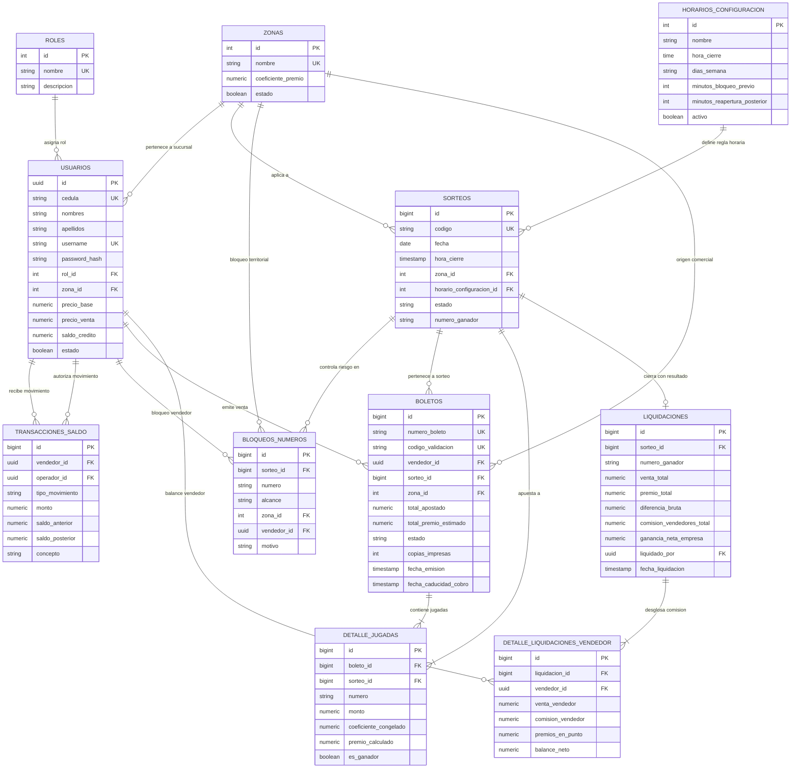

# Diagrama Entidad-Relación (ERD) - SISTEMA_VENTAS_LO

## 1. Diagrama de Entidades y Relaciones



---

## 2. Diccionario de Datos y Reglas de Negocio Clave

### A. Coeficiente de Premio y Congelamiento
* Al registrar un boleto, el campo `coeficiente_congelado` en `detalle_jugadas` almacena el valor vigente de la zona del vendedor en ese milisegundo exacto.
* Si el administrador modifica el coeficiente de una zona posteriormente (CU01), los boletos ya emitidos conservan su cálculo original inmutable.

### B. Validación Estricta de Dígitos (00-99)
* Las columnas de números de jugada (`detalle_jugadas.numero`), sorteos (`sorteos.numero_ganador`) y bloqueos (`bloqueos_numeros.numero`) cuentan con restricción:
  ```sql
  CHECK (numero ~ '^[0-9]{2}$')
  ```
  Esto garantiza siempre formato de 2 caracteres (`00`, `01` ... `99`).

### C. Control de Límites de Riesgo (CU04)
* Índice compuesto `idx_jugadas_sorteo_numero (sorteo_id, numero)` para sumarizar el dinero acumulado en milisegundos en la consulta de la cuadrícula global.
* Verificación previa contra la tabla `bloqueos_numeros` antes de permitir la inserción de jugadas.

### D. Protocolo Antifraude en Impresión Térmica (CU09)
* La columna `copias_impresas` en `boletos` inicia en `0` (Ticket Original).
* Cada reimpresión invoca un trigger/update que incrementa el contador (+1) e inyecta la marca de agua `COPIA X`.

### E. Integridad Transaccional de Saldo y Cierre (CU05, CU08)
* Toda emisión descuenta de `usuarios.saldo_credito`.
* Toda anulación antes de los 5 minutos de cierre devuelve el importe al saldo y registra la traza en `transacciones_saldo`.
* La liquidación genera el balance vendedor en `detalle_liquidaciones_vendedor` calculando la ganancia según `precio_venta - precio_base`.
